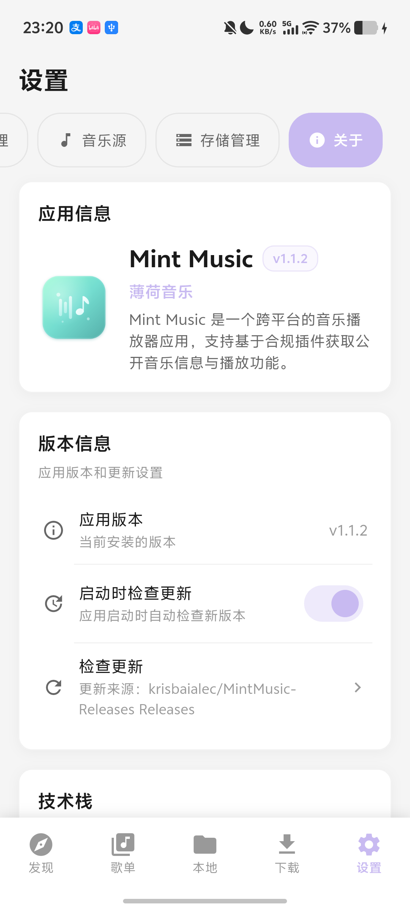

# 薄荷+

自定义插件音源、聚合搜索、本地音乐、收藏歌单、下载、普通歌词、AMLL 与桌面歌词。

本仓库提供发布说明、许可证、更新日志、界面截图和 Release APK。源码及开发历史暂保存在私人仓库，公开版本由维护者手动决定，不自动同步。

<!-- RELEASE-STATUS -->
最新正式版：[v1.1.3](https://github.com/krisbaialec/MintMusic-Releases/releases/tag/v1.1.3)。文件 MintPlus-1.1.3-arm64-release.apk，40,391,210 字节。

SHA-256：`92ac618a6735974602ea577cdb49dc34b016d8be26dd69b6d7912b173a826c6b`。
<!-- /RELEASE-STATUS -->

## 下载与安装

[Releases 页面](https://github.com/krisbaialec/MintMusic-Releases/releases) · [最新正式版入口](https://github.com/krisbaialec/MintMusic-Releases/releases/latest)。尚无正式 Release 时，最新入口返回 404，不能据此判断应用已是最新版。

1. 正式发布后从上述入口下载名称带 `arm64-release.apk` 的 APK，适用于 Android 7.0 及以上 ARM64 手机。
2. 在 Android 中允许所使用的浏览器或文件管理器安装未知来源应用，再打开 APK 安装。
3. 本修改版包名为 `com.kingmc.mintmusic.mintmusic.dev`。只有与旧版包名、签名一致且版本号递增时才能覆盖升级保留数据；签名不同请停止，不要卸载旧版或清除数据。
4. 可用 PowerShell `Get-FileHash <APK路径> -Algorithm SHA256` 核对 Release 说明中的 SHA-256。

## 功能与修改

独立公开更新源；桌面歌词逐词渐进着色；HEX/HSV 配色；恢复原有字体、字体菜单和 AMLL 字体加载；版本显示与构建版本统一。

个人修改版使用独立 `.dev` 包名，可与原作者的正式版并存。版本号属于本修改版；公开更新检查只连接本仓库，不向私人仓库索取版本，也不回退到原项目更新源。

## 截图

## 来源、作者与许可

原项目 [kingmuchen/Mint-Music](https://github.com/kingmuchen/Mint-Music)，原作者 kingmuchen；Copyright (c) 2026 kingmuchen，MIT。

Android 桌面歌词实现参考 [lyswhut/lx-music-mobile](https://github.com/lyswhut/lx-music-mobile)，Apache-2.0。相关修改由本修改版承担；本版本不代表原作者的官方发行。

完整主项目许可及已收集的第三方声明见 [LICENSE](LICENSE)。主项目的 MIT 许可不替代第三方组件的独立许可，也不表示原项目的代码变成专有许可。

<!-- LICENSE-REVIEW -->
AMLL Core 0.5.1 的源码提供安排、JAudioTagger LGPL 分发材料和原有字体授权仍待核实；用途声明不替代许可证。
<!-- /LICENSE-REVIEW -->

## 使用声明

本修改版免费提供，仅供个人学习、技术研究和交流，请勿用于商业用途或侵犯他人权益。

音乐、歌词、封面等资源的权利属于相应权利人。请通过合法授权渠道使用资源并支持正版；对学习测试下载的资源，请在下载后 24 小时内删除。

本项目不提供音乐资源、账号或内置音源授权。使用者应确认自己导入的音源及使用资源的授权范围。权利人可通过本仓库 Issues 联系维护者处理相关内容。

以上用途说明不替代原项目及第三方组件的许可证，也不承诺免除法律责任。

## 测试与已知问题

恢复原有字体及加载方式；APK 内两份原字体与本地原件逐字一致。更新及版本显示专项 6 项通过。手机现已安装 1.1.3，已只读核对安装包与公开 APK 的 SHA-256 完全相同，签名及首次安装时间保持一致。本次升级由设备端完成，未由自动化重复安装。实际字体显示、设置数据的 UI 对照和更新弹窗尚未由本次自动化确认；未改动功能沿用此前测试。此前受控原生双语、精确逐词填充和长句滚动用例未验证，保留此限制。

当前仅在一台 ARM64 Android 手机上检查。其他设备、真实 16 KB 页设备、全部在线音源与格式组合未验证。测试日志、音源配置、歌单数据和手机信息不上传到此仓库。

公开状态以页首为准；未请求发布时继续私人开发。具体第三方许可待办如实保留，不将用途声明当作许可已解决的证明。

## 更新日志

见 [CHANGELOG.md](CHANGELOG.md)。
